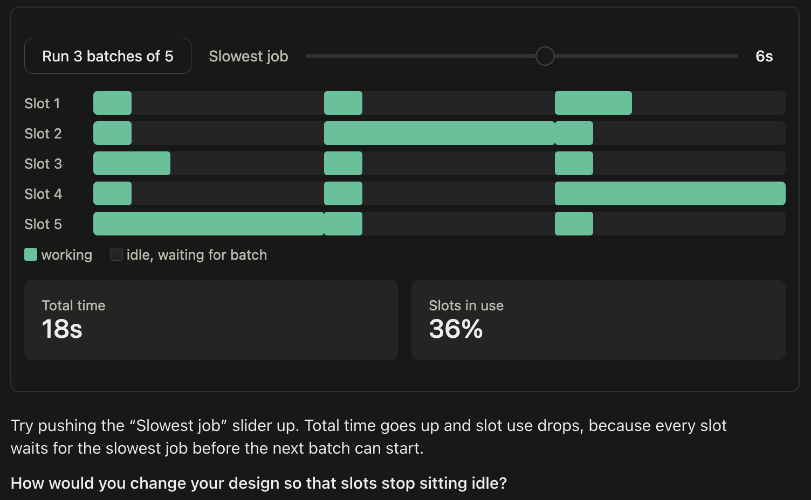
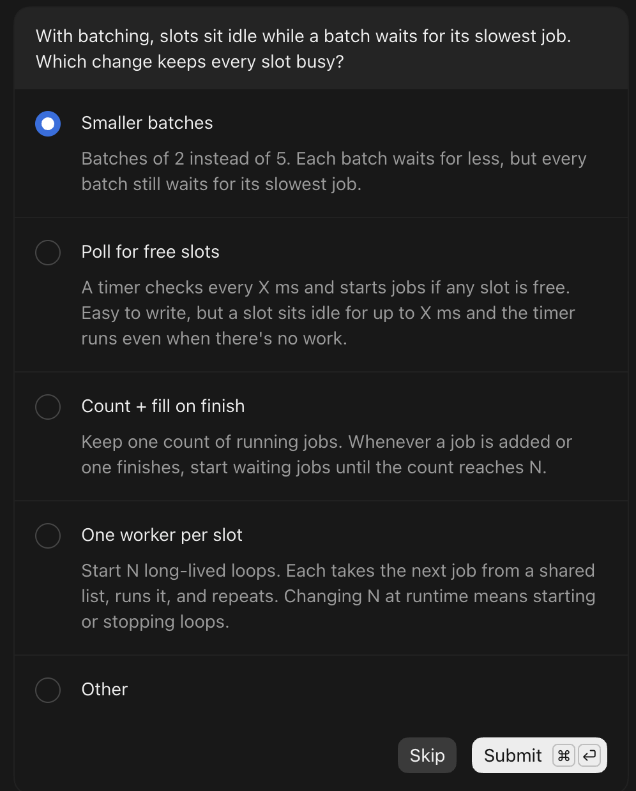
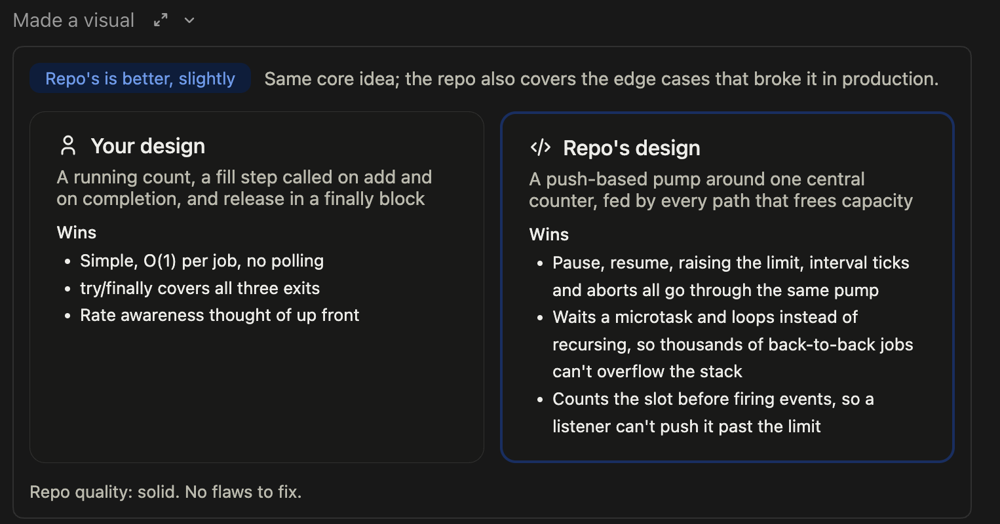
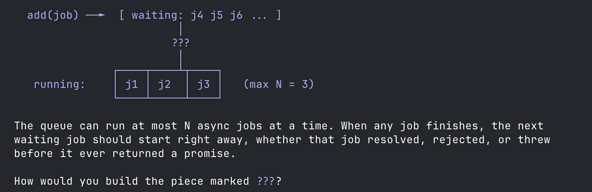
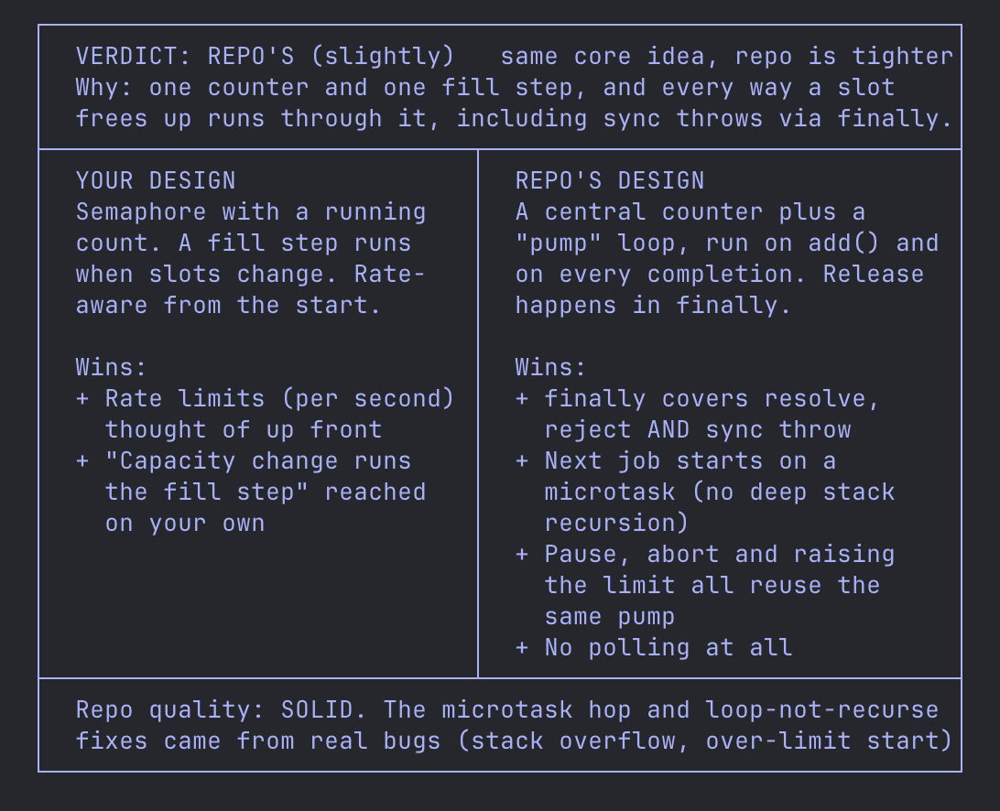

# Design Duel 🦊⚔️

**You vs. the code. Design it yourself, then find out whose version is better.**

[](https://github.com/anthonysfox/design-duel/actions/workflows/validate.yml)
[](https://github.com/anthonysfox/design-duel/releases)
[](LICENSE)
[](#install)

<!-- DEMO GIF: record one round (problem, a constraint, the verdict), save it as assets/demo.gif, then delete these comment markers:
<p align="center"></p>
-->

AI can write a whole app in an afternoon. The hard part comes later, when someone asks *"why did you build it this way?"* and you realize you're not totally sure.

Design Duel is a skill for Claude that fixes that. Instead of explaining your codebase to you, it hands you the problems the code solves and asks how *you* would solve them. Then it adds real-world constraints one at a time until your design either holds up or breaks. At the end, it puts your design next to what's actually in the repo and gives an honest verdict.

Sometimes the repo wins and you learn why. Sometimes **you** win, and you've just found a bug in the code.

---

## What a round looks like

Here's a real round from a playlist sync app:

> **Problem:** Your sync runs every hour. What happens to a playlist's "next sync time" after a run?
>
> **You:** On success, move it to the next scheduled slot. On failure, leave it alone so it retries.
>
> **Constraint:** A user disconnects Spotify and stays gone for 30 days. *[drag the slider]* That's 720 failed attempts, all clogging your run history.
>
> **You:** Then flag disconnected users and leave them out of the query. For real failures, back off (1h, 2h, 4h), then wait for the next slot.
>
> **Verdict:** Same core design as the repo, but the repo retries failures every hour forever. **Yours is better.** Added to your fix log.

---

## Desktop app vs. terminal

The questions, constraints and verdicts are the same everywhere. What changes is how they look.

### Claude desktop app (Code tab): interactive

Every step is something to play with: drag a slider until your design breaks, pick from approach cards when you're stuck, and get the verdict as a side-by-side card. You type your designs in the chat as usual, and choices are one click. This is the best way to use Design Duel.

<p align="center">
  
</p>
<p align="center"><em>A constraint breaks your design: slow jobs leave the other slots idle.</em></p>

<p align="center">
  
</p>
<p align="center"><em>Stuck? You get real approaches with trade-offs, never the answer.</em></p>

<p align="center">
  
</p>
<p align="center"><em>The verdict: your design next to the repo's, honest both ways.</em></p>

### Terminal and VS Code: text

Same session, drawn in ASCII, with multiple-choice pickers for options. Works anywhere Claude Code runs.

<p align="center">
  
</p>
<p align="center"><em>The problem as an ASCII sketch, with the missing piece marked <code>???</code>.</em></p>

<p align="center">
  
</p>
<p align="center"><em>The same verdict as a text box.</em></p>

All screenshots are from a real session on [sindresorhus/p-queue](https://github.com/sindresorhus/p-queue).

---

## How it works

```
 1. Why does this project exist?        ← you answer in your own words
          │
 2. Claude maps the repo in the background
    (5 to 10 real design decisions, ordered
     the way you'd build it from scratch)
          │
 3. For each decision:
    ┌──────────────────────────────────┐
    │  problem → your design           │
    │  + constraint → does it break?   │
    │  + constraint → does it break?   │
    │  stuck? → pick from options      │
    └──────────────────────────────────┘
          │
 4. Verdict: yours vs. the repo's
          │
 5. Logged: what you nailed, what to review,
    and any bugs found in the repo
```

The answers are hidden in a file outside your repo, so you can't peek at them in your editor by accident.

---

## Install

### Claude Code (recommended)

```
/plugin marketplace add anthonysfox/design-duel
/plugin install design-duel@design-duel
```

Or with the skills CLI:

```
npx skills add anthonysfox/design-duel
```

### Claude app (claude.ai, desktop, mobile)

1. Download `design-duel-skill.zip` from the [latest release](https://github.com/anthonysfox/design-duel/releases), or zip the `skills/design-duel` folder yourself.
2. In Claude, go to **Customize → Skills** and upload the zip.
3. Skills you add there also sync to Claude Code when you're signed in with the same account.

### By hand

Copy `skills/design-duel` into `~/.claude/skills/` (works in every project) or `.claude/skills/` inside one repo.

---

## Use it

| Command | What it does |
| --- | --- |
| `/design-duel` | Duel the repo you're in |
| `/design-duel <path>` | Duel a local repo |
| `/design-duel <github-url>` | Clone and duel someone else's repo |
| `/design-duel review [repo]` | Re-try the problems you struggled with last time (this repo, or one you name) |
| `/design-duel interview [repo]` | Turn your session into interview talking points, then run a mock round |

You can also just talk to it: *"I'm stuck"*, *"skip this one"*, *"start over"*, *"how many problems are there?"*

---

## Good for

- **Projects you built with AI.** Find out which parts you actually understand.
- **Interview prep.** Practice explaining *why* your project works the way it does, then rehearse it in interview mode.
- **Learning a famous open-source repo** by rebuilding its design decisions yourself.
- **Code review.** The verdict step regularly turns up real bugs, races, and dead code.

---

## What it saves

Everything lives in `~/.design-duel/<repo-name>/`, never inside your repo:

| File | What's in it |
| --- | --- |
| `map.md` | The answers. Don't open it until you're done! |
| `log.md` | Per problem: verdict, where you got stuck, what you found on your own |
| `fixes.md` | Bugs and improvements found in your repo, with priority and file paths |
| `talking-points.md` | Interview answers, written from your session |
| `src/` | The clone, when you duel a repo by URL. It's kept here rather than in your current folder so its own Claude config never loads into your workspace |

In the Claude app, it can keep the fix log as a Sheet instead, with Priority and Status dropdowns you can update from your phone.

Want to see what these look like? Check out the [example output](examples/) from a made-up URL shortener.

---

## Safety

- **Read-only on your code.** It runs only read-only git commands and reads files. It never edits your repo.
- **Never runs the repo's code.** No install steps, scripts, or tests, which matters when you point it at a stranger's repo.
- **Prompt-injection aware.** Anything in the repo (README, comments, commit messages) is treated as material to study, never as instructions. If something in there tries to give Claude orders, it tells you instead of following them.
- **No telemetry.** It's one markdown file. Read it yourself: [`skills/design-duel/SKILL.md`](skills/design-duel/SKILL.md).

---

## FAQ

**Does it work on any language?**
Yes. It reads code, imports, and git history, so any language Claude can read works.

**What if my repo has no git history?**
It builds the map from the code alone.

**Will it just tell me the answer if I ask?**
No, not before the verdict. If you're stuck, it narrows things down to a few options. After two misses in a row, it sketches the problem for you, but never the missing piece.

**Is the repo always right?**
No, and that's the point. Plenty of AI-written code has real flaws. If your design beats it, the verdict says so.

---

## Contributing

Found a bad round or have an idea? Open an [issue](https://github.com/anthonysfox/design-duel/issues/new/choose), or see [CONTRIBUTING.md](CONTRIBUTING.md) to test changes locally. Release notes live in the [CHANGELOG](CHANGELOG.md).

---

## Credits

Built on [rederive](https://github.com/EricJujianZou/rederive) by Eric Zou (MIT), which pioneered the "rederive the design yourself" approach. The skill is adapted from rederive's, and its copyright notice is kept in [LICENSE](LICENSE). Design Duel adds the head-to-head verdict, review and interview modes, the fix log, and interactive rounds.

Made by [Anthony Fox](https://anthonyfox.dev). MIT licensed.
